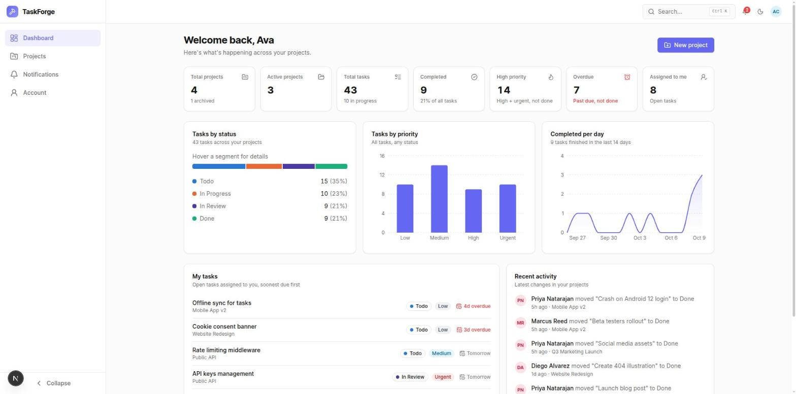
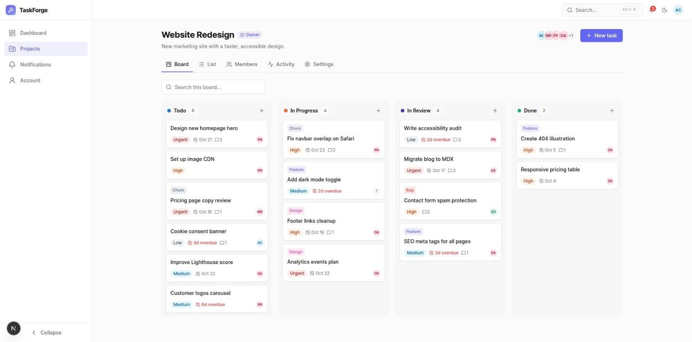

# TaskForge

A project and task management web app for small teams. Create projects, invite members with roles, plan work on a kanban board or a filterable list, discuss tasks in comments, and follow progress on a dashboard.

This repository is the **frontend**. It talks to the TaskForge REST API (the backend lives in its own repository, with its own database, migrations and seed data).




## Contents

- [Tech stack](#tech-stack)
- [Features](#features)
- [Getting started](#getting-started)
- [Environment variables](#environment-variables)
- [Demo accounts](#demo-accounts)
- [User guide](#user-guide)
- [Roles and permissions](#roles-and-permissions)
- [Keyboard shortcuts](#keyboard-shortcuts)
- [Scripts](#scripts)
- [Project structure](#project-structure)
- [Conventions](#conventions)
- [API](#api)
- [Troubleshooting](#troubleshooting)
- [Decisions and trade-offs](#decisions-and-trade-offs)
- [Not included yet](#not-included-yet)

## Tech stack

| Area              | Choice                                                                          |
| ----------------- | ------------------------------------------------------------------------------- |
| Framework         | Next.js 15 (App Router), React 19, TypeScript                                   |
| Styling           | Tailwind CSS 3, Radix UI primitives (shadcn style), dark mode via `next-themes` |
| Server state      | TanStack Query 5                                                                |
| UI state          | Zustand                                                                         |
| Forms             | React Hook Form + Zod                                                           |
| Drag and drop     | dnd-kit (mouse, touch and keyboard)                                             |
| Charts            | Recharts                                                                        |
| Command palette   | cmdk                                                                            |
| Loading skeletons | boneyard-js (generated from the real UI)                                        |
| Tooling           | ESLint, Prettier, Husky, lint-staged, commitlint                                |

## Features

- **Auth**: sign up, sign in, forgot and reset password, silent session refresh (access token kept in memory, refresh token in an httpOnly cookie), protected pages.
- **Dashboard**: headline stats, tasks by status and priority, 14-day completion trend, my tasks, recent activity.
- **Projects**: search, status filter, grid and list views, pagination, create, edit, archive and restore, delete with typed confirmation.
- **Board**: drag cards between columns (Todo, In Progress, In Review, Done), optimistic updates with rollback, quick add per column.
- **List**: debounced search, filters (status, priority, assignee, overdue), sorting and pagination. All state lives in the URL, so a filtered view can be shared.
- **Task drawer**: edit every field, comments, delete, unsaved-changes guard, read-only view when you lack rights.
- **Members**: add people by search, change roles, remove, leave, transfer ownership.
- **Activity**: a timeline of everything that happened in a project.
- **Notifications**: bell with unread badge, full page, mark one or all as read.
- **Account**: profile name, change password, light, dark or system theme.
- **Productivity**: command palette and keyboard shortcuts.
- **Polish**: responsive from 360 px, loading skeletons, friendly empty, error and 404 states.

## Getting started

### Requirements

- **Node.js 18.18 or newer** (Node 22 recommended)
- **npm** (comes with Node)
- A running **TaskForge backend API**. A deployed one is already set as the default (see below), so you can start without running your own.

### Install and run

```bash
# 1. Clone and enter the project
git clone git@github.com:naimur61/task-forge.git
cd task-forge

# 2. Install dependencies
npm install

# 3. Create your environment file
cp .env.example .env.local

# 4. Start the dev server
npm run dev
```

Open **http://localhost:4000** and sign in with a [demo account](#demo-accounts).

### Production build

```bash
npm run build
npm start        # serves on http://localhost:4000
```

### Using your own backend

Run the backend repository (database, migrations and seed data are set up there), then point the frontend at it in `.env.local`:

```bash
NEXT_PUBLIC_API_URL=http://localhost:4040/api/v1
```

Restart `npm run dev` after changing the file. The backend must allow the origin `http://localhost:4000` in CORS **with credentials**, because the browser calls the API directly and the refresh cookie travels with each request.

## Environment variables

| Variable              | Required | Description                                                                                                                |
| --------------------- | -------- | -------------------------------------------------------------------------------------------------------------------------- |
| `NEXT_PUBLIC_API_URL` | Yes      | Base URL of the backend API, including the version prefix, for example `https://task-forge-server-theta.vercel.app/api/v1` |

`.env.local` is ignored by git. Only `.env.example` is committed.

## Demo accounts

The backend seed data includes these users. The login page has one-click buttons that fill the form. The password for all of them is `Demo1234!`.

| Email                                              | Name              | Role in the "Website Redesign" project |
| -------------------------------------------------- | ----------------- | -------------------------------------- |
| `owner@demo.dev`                                   | Ava               | Owner                                  |
| `admin@demo.dev`                                   | Marcus            | Admin                                  |
| `member@demo.dev`                                  | Priya             | Member                                 |
| `diego@demo.dev`, `sara@demo.dev`, `liam@demo.dev` | Diego, Sara, Liam | Members                                |

Tip: sign in as different roles in separate browser windows (use a private window for the second one) to see how permissions change what you can do.

## User guide

### 1. Sign in or create an account

Open the app and choose **Sign in** or **Create account**. Use a demo account to explore quickly. If you forget your password, use **Forgot password** on the sign-in page. Your session refreshes silently, so you stay signed in across page reloads until you sign out from the user menu (top right).

### 2. Find your way around

- **Sidebar** (bottom bar on phones): Dashboard, Projects, Notifications, Account.
- **Top bar**: search and command palette, the notification bell, theme toggle and the user menu.

### 3. Dashboard

The first screen after sign-in. It shows your totals, the status and priority charts, a completion trend, the tasks assigned to you, and recent activity. If you have no projects yet, it offers a shortcut to create one.

### 4. Create a project

Go to **Projects**, click **New project**, enter a name and optional description, and save. You become the **Owner**. Use the search box, status filter and grid/list toggle to manage many projects. Archive a project to hide it from the active list, or delete it (you must type its name to confirm).

### 5. Add members

Open a project, then the **Members** tab. Click **Add member**, search by name or email, pick a role and confirm. Owners can change roles and transfer ownership; owners and admins can remove members. Anyone except the owner can leave a project.

### 6. Work with tasks

A project has four views, shown as tabs: **Board**, **List**, **Members**, **Activity** (plus **Settings** for owners and admins).

- **Create a task**: click **New task**, or use the quick add at the bottom of a board column. A task has a title, description, status, priority, assignee, due date and labels.
- **Board**: drag a card to another column to change its status. On touch screens press and drag; with a keyboard focus a card, press Space to pick it up, use the arrow keys to move and Space to drop.
- **List**: search, filter, sort and paginate. The address bar always reflects the current view, so copying the link shares it.
- **Task drawer**: click any task to open it. Edit fields, add comments, edit or delete your own comments, or delete the task if your role allows it. Closing with unsaved edits asks for confirmation.

### 7. Notifications

You are notified when something relevant to you happens, for example when you are assigned a task. The bell shows the unread count. Click a notification to open the related task, or use **Mark all read**. The full list is under **Notifications**.

### 8. Account and theme

Under **Account** you can change your display name and password and pick a light, dark or system theme.

## Roles and permissions

Each person has one role per project. The interface hides or disables controls you can't use, and the backend enforces the same rules.

| Action                                  | Owner | Admin |     Member     |
| --------------------------------------- | :---: | :---: | :------------: |
| View project, tasks and comments        |  Yes  |  Yes  |      Yes       |
| Create tasks and comments               |  Yes  |  Yes  |      Yes       |
| Edit or delete own or assigned tasks    |  Yes  |  Yes  | Own / assigned |
| Edit or delete any task                 |  Yes  |  Yes  |       No       |
| Delete any comment                      |  Yes  |  Yes  |       No       |
| Manage labels                           |  Yes  |  Yes  |       No       |
| Add or remove members                   |  Yes  |  Yes  |       No       |
| Change member roles                     |  Yes  |  No   |       No       |
| Edit project details                    |  Yes  |  Yes  |       No       |
| Archive, delete or transfer the project |  Yes  |  No   |       No       |
| Leave the project                       |  No   |  Yes  |      Yes       |

Projects you don't belong to return "not found", and actions your role can't do return "forbidden". The full rule set is in `src/lib/permissions.ts`.

## Keyboard shortcuts

Press `?` anywhere in the app to see this list.

| Keys                 | Action                                                              |
| -------------------- | ------------------------------------------------------------------- |
| `Ctrl` / `Cmd` + `K` | Open the command palette (jump to a project, create a task, search) |
| `C`                  | New task (inside a project) or new project                          |
| `/`                  | Focus the search box                                                |
| `G` then `D`         | Go to dashboard                                                     |
| `G` then `P`         | Go to projects                                                      |
| `G` then `N`         | Go to notifications                                                 |
| `?`                  | Show shortcuts                                                      |

## Scripts

| Script                           | What it does                                                                    |
| -------------------------------- | ------------------------------------------------------------------------------- |
| `npm run dev`                    | Dev server on http://localhost:4000                                             |
| `npm run build`                  | Production build                                                                |
| `npm start`                      | Serve the production build on port 4000                                         |
| `npm run lint`                   | ESLint                                                                          |
| `npm run typecheck`              | TypeScript check without emitting files                                         |
| `npm run bones`                  | Re-capture loading skeletons (dev server must be running)                       |
| `npm run theme:preset -- <name>` | Switch the color preset (amber, blue, cyan, emerald, mono, rose, slate, violet) |

Git hooks (Husky) run lint-staged on commit, check commit messages against [Conventional Commits](https://www.conventionalcommits.org/) (for example `feat(auth): add password reset`), and run typecheck, lint and build before a push.

## Project structure

```
src/
├─ app/                     routes: page.tsx → *-container.tsx (+ service.ts for API calls)
│  ├─ (auth)/               login, register, forgot and reset password
│  ├─ (app)/                signed-in shell (sidebar, top bar, command palette)
│  │  ├─ dashboard/  projects/[projectId]/{board,list,members,activity,settings}/
│  │  └─ notifications/  account/
├─ components/
│  ├─ ui/                   raw shadcn primitives (never edited)
│  ├─ ui/custom/            customized copies of primitives
│  ├─ common/               shared, domain-free (EmptyState, ConfirmDialog, fields, schemas)
│  ├─ layouts/              sidebar, top bar, mobile nav
│  └─ features/             UI per domain (tasks, projects, members, dashboard, ...)
├─ hooks/api-hooks/         useFetchData / useApiMutation (the only way to call the API)
├─ store/zustand/           auth session and small UI state
├─ providers/               auth bootstrap, query, theme, toast
├─ bones/                   generated loading skeletons
├─ lib/                     permissions, http helpers, date utils
└─ types/                   one file per domain (task.ts, project.ts, ...)
```

## Conventions

The full version is in [`guide.md`](guide.md). In short:

- `page.tsx` only renders a container. Containers hold state. Components get props and callbacks.
- API calls live only in a route's `service.ts`, built on `@/hooks/api-hooks`. Calls shared by several pages go in the nearest shared parent's `service.ts`.
- The folder names the role and the file names the thing (`types/task.ts`, not `task.type.ts`). Files are kebab-case.
- Server state lives in TanStack Query, list filters in the URL, and small UI state in Zustand.

## API

The full API is described in [`openapi.json`](openapi.json) (OpenAPI 3). Import it into Swagger Editor, Postman or Insomnia to browse every endpoint. The conventions the frontend relies on:

- **Resources** return `{ data, meta? }`. Lists include `meta: { page, limit, total, totalPages, hasNext, hasPrev }`.
- **Errors** return `{ statusCode, error, message, code, details: [{ field, message }] }`. Field details appear next to the matching form inputs.
- **Auth**: `login` and `register` return `{ user, accessToken }` and set the refresh cookie. `refresh` returns `{ accessToken }`. `me` returns the user. These are not wrapped in `data`. Token refresh lives in `src/lib/http/auth-fetch.ts`.

## Troubleshooting

| Problem                                                            | Fix                                                                                                                                                              |
| ------------------------------------------------------------------ | ---------------------------------------------------------------------------------------------------------------------------------------------------------------- |
| Login fails with "Internal server error" or the network errors out | The backend is unreachable or down. Check `NEXT_PUBLIC_API_URL`, open `<API URL>/health` in the browser, and retry in a minute if you use the free deployed API. |
| CORS error in the browser console                                  | The backend must allow `http://localhost:4000` with credentials.                                                                                                 |
| Signed in, but a reload logs you out                               | The refresh cookie is not being stored. The backend must send it with `SameSite=None; Secure` when the API is on another domain over HTTPS.                      |
| Changed `.env.local` but nothing changed                           | Restart `npm run dev`. `NEXT_PUBLIC_` values are read at start-up and at build time.                                                                             |
| Port 4000 is busy                                                  | Stop the other process, or run `npx next dev -p 4001` (then allow that origin in the backend CORS).                                                              |
| `npm install` fails on an old Node                                 | Use Node 18.18 or newer.                                                                                                                                         |

## Decisions and trade-offs

- **Client-side route guard** (`RequireAuth`) instead of `middleware.ts`: the refresh cookie belongs to the API's domain, so Next.js middleware can't read it when the backend runs elsewhere.
- **Server-side sorting and pagination** with the plain `ui/table` instead of TanStack Table, because the API already sorts and pages.
- **Optimistic board moves** with fractional positions, rolled back if the server refuses.
- **Charts are lazy-loaded**, which keeps Recharts out of the dashboard's first load.
- **URL as the source of truth** for list filters, sort, page and the open task.

## Not included yet

- Real-time updates (changes by teammates appear after a refresh)
- Automated tests
- File attachments, bulk task actions, i18n, offline mode
